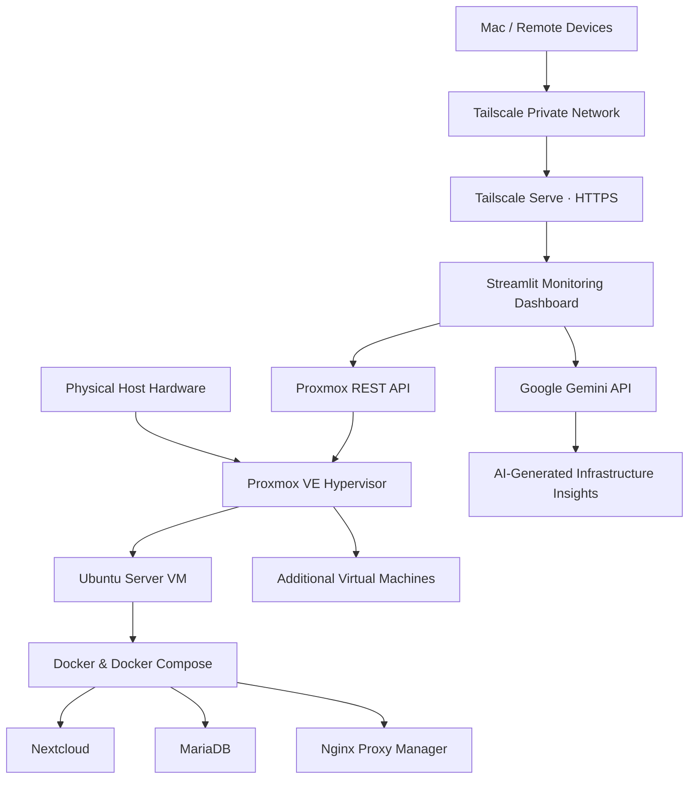
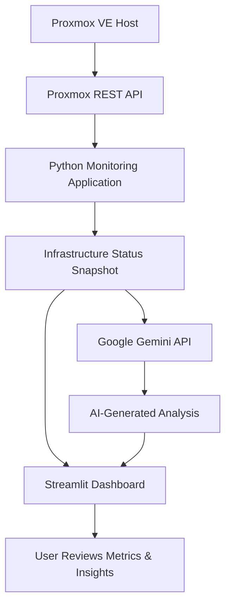

# AI-Powered Proxmox Homelab

**A secure, self-hosted infrastructure environment combining virtualization, network security, and AI-assisted infrastructure monitoring.**

This project is an ongoing homelab built using [Proxmox VE](https://www.proxmox.com/en/products/proxmox-virtual-environment/overview) to explore virtualization, Linux system administration, network security, and infrastructure management.

The environment runs on repurposed hardware and hosts virtual machines and self-hosted services. I expanded the project by developing a custom Python monitoring dashboard that integrates the Proxmox REST API with Google's Gemini API to retrieve infrastructure metrics and generate AI-assisted operational insights.

The project emphasizes secure infrastructure management through network segmentation, firewall policies, least-privilege permissions, TLS verification, and private remote access.

---

## Project Objectives

- Build and maintain a self-hosted virtualized infrastructure environment.
- Develop practical experience with Linux administration, virtualization, and infrastructure management.
- Apply cybersecurity principles through firewall configuration, network segmentation, and access controls.
- Build a custom application to monitor infrastructure health through the Proxmox REST API.
- Integrate AI to analyze infrastructure data and generate operational insights.
- Explore secure remote administration and cloud infrastructure concepts.

---

## Technology Stack

| Category | Technologies |
|---|---|
| Virtualization | Proxmox VE |
| Operating Systems | Debian, Ubuntu Server |
| Programming | Python |
| Dashboard | Streamlit |
| AI Integration | Google Gemini API |
| Infrastructure API | Proxmox REST API |
| Containers | Docker, Docker Compose |
| Networking | Tailscale, WireGuard |
| Security | Linux permissions, firewall policies, TLS/HTTPS |
| Development Tools | Linux Terminal, SSH, Git, Python virtual environments |

---

## Infrastructure Architecture

The homelab uses Proxmox VE as its central virtualization platform. Virtual machines run individual services and applications, while the AI monitoring application communicates with the Proxmox API to retrieve infrastructure information.

### Infrastructure Overview



### Virtualization & Services

**Proxmox VE**
- Centralized virtualization and virtual machine management.
- Hosts multiple virtual machines and isolated workloads.
- Provides infrastructure metrics through its REST API.
- Uses firewall policies and access controls to protect the environment.

**Ubuntu Server VM**
- Hosts the Python-based monitoring application.
- Runs Docker and Docker Compose for self-hosted services.
- Hosts Nextcloud and supporting services, including MariaDB and Nginx Proxy Manager.
- Provides the application environment for AI-assisted infrastructure monitoring.

**Remote Access**
- Uses Tailscale to establish private connectivity between authorized devices.
- Uses Tailscale Serve to provide HTTPS access to the monitoring dashboard within the private network.
- Avoids exposing the monitoring dashboard through a publicly accessible internet endpoint.

---

## AI-Powered Infrastructure Monitoring

A major component of this project is a custom infrastructure monitoring application built with Python and Streamlit.

The application connects to the Proxmox REST API to retrieve infrastructure data and presents the information through an interactive dashboard. Google Gemini is integrated to interpret infrastructure status snapshots and generate natural-language operational insights.

### Dashboard Capabilities

| Feature | Description |
|---|---|
| CPU Monitoring | Retrieves and displays Proxmox node CPU utilization. |
| Memory Monitoring | Displays node memory usage and utilization. |
| Filesystem Monitoring | Retrieves filesystem utilization information. |
| Virtual Machine Monitoring | Displays virtual machine statuses and resource information. |
| AI-Assisted Analysis | Sends infrastructure status snapshots to Gemini for analysis and operational recommendations. |
| Interactive Dashboard | Presents monitoring data and AI analysis through a Streamlit web interface. |

### AI Integration Workflow



**How it works:**

1. The Python application authenticates with the Proxmox REST API using a dedicated API token.
2. The application retrieves current node and virtual machine information.
3. Infrastructure metrics are displayed in the Streamlit dashboard.
4. When requested, a status snapshot is submitted to the Google Gemini API.
5. Gemini analyzes the provided information and returns natural-language insights.
6. The user reviews the results alongside the live infrastructure metrics.

**AI Security Design**

The AI integration currently operates as an advisory monitoring component. Gemini analyzes the infrastructure information provided to it but does not have direct shell access, Proxmox administrative permissions, or the ability to independently modify infrastructure.

This separation helps maintain a distinction between AI-generated recommendations and privileged infrastructure operations.

---

## Cybersecurity & Infrastructure Security

Security is a central consideration throughout the project. The environment incorporates multiple controls designed to reduce unnecessary exposure and restrict administrative access.

### Network Security & Segmentation
- Configured and tested Proxmox datacenter-level and node-level firewall policies.
- Applied network segmentation principles across virtualized services.
- Restricted network access to reduce unnecessary communication between workloads.
- Designed the environment around limiting exposure of administrative interfaces.

### Identity & Access Management
- Created dedicated non-root administrative accounts.
- Applied scoped `sudo` privileges for administrative operations.
- Disabled direct root SSH authentication.
- Created a dedicated Proxmox API identity and token for the monitoring application.
- Assigned the `PVEAuditor` role to the monitoring token to enforce read-only API permissions.

### Secure Remote Access & API Communication
- Used Tailscale for private remote connectivity.
- Configured Tailscale Serve to provide HTTPS access to the monitoring dashboard.
- Enabled TLS certificate verification when communicating with the Proxmox API.
- Used the Proxmox certificate authority to validate API connections.

### Secrets Management
- Stored API credentials and configuration values in environment variables.
- Used a local `.env` file for application configuration.
- Excluded sensitive configuration files and certificate material from version control.

---

## Project Structure

The repository is organized to separate application code, documentation, and supporting resources.

```text
Proxmox-Homelab/
│
├── README.md
├── LICENSE
├── .gitignore
│
├── AI-Monitor/
│   ├── app.py
│   ├── test_pve.py
│   ├── requirements.txt
│   ├── .env.example
│   └── .gitignore
│
├── docs/
│   ├── architecture.md
│   ├── security.md
│   └── troubleshooting.md
│
└── screenshots/
    └── (Dashboard screenshots will be added)
```

*Note: This is the intended documentation and source-code organization. Update the structure as files are added to the public repository. Do not publish local secrets or private certificate files.*

---

## Running the AI Monitoring Dashboard

The monitoring application runs on an Ubuntu Server VM.

### Prerequisites

- Python 3.10 or later.
- Access to a Proxmox VE environment.
- A dedicated Proxmox API user and token with appropriate read-only permissions.
- A Google Gemini API key.
- The Proxmox certificate authority file for TLS verification.
- Tailscale installed if private remote access is desired.

### 1. Clone the Repository

```bash
git clone https://github.com/MVD-Standard/Proxmox-Homelab.git
cd Proxmox-Homelab/AI-Monitor
```

### 2. Create a Python Virtual Environment

```bash
python3 -m venv .venv
source .venv/bin/activate
```

### 3. Install Dependencies

```bash
pip install -r requirements.txt
```

### 4. Configure Environment Variables

Create a local `.env` file using `.env.example` as a reference.

```env
GEMINI_API_KEY=your_gemini_api_key
GEMINI_MODEL=your_supported_gemini_model

PVE_URL=https://your-proxmox-hostname:8006
PVE_NODE=your_proxmox_node
PVE_TOKEN_ID=your_api_token_id
PVE_TOKEN_SECRET=your_api_token_secret
PVE_CA=/path/to/pve-root-ca.pem
```

Replace the placeholder values with your own configuration. The Proxmox hostname must match the certificate identity used for TLS verification.

**Never commit your actual `.env` file, API keys, token secrets, or private certificates to GitHub.**

### 5. Launch the Dashboard

```bash
streamlit run app.py --server.address 127.0.0.1 --server.port 8501
```

The application will be available locally at:

```text
http://127.0.0.1:8501
```

Private remote access can be configured separately through Tailscale Serve.

---

## Roadmap & Future Development

This project is continuously evolving, with plans to expand infrastructure visibility, improve monitoring capabilities, and explore additional security integrations.

- [ ] **Resource Alerts:** Implement CPU, memory, and storage threshold-based alerts.
- [ ] **Historical Metrics:** Store infrastructure metrics over time to identify resource trends and performance changes.
- [ ] **Enhanced AI Analysis:** Expand Gemini-powered analysis to identify recurring resource issues and provide more detailed recommendations.
- [ ] **Centralized Logging:** Explore centralized log collection and SIEM integration.
- [ ] **Security Monitoring:** Explore network traffic analysis and suspicious activity detection.
- [ ] **Automated Backups:** Implement scheduled backups and recovery testing.
- [ ] **Documentation & Visualization:** Add dashboard screenshots, deployment diagrams, and additional setup documentation.

---

## Skills Demonstrated

- Virtualization & Infrastructure Management
- Linux System Administration
- Network Security & Segmentation
- Firewall Configuration
- Identity & Access Management
- REST API Integration
- Python Application Development
- AI API Integration
- Infrastructure Monitoring
- Secure Remote Access
- TLS Certificate Verification
- Containerization & Service Deployment

---

## Project Status

The homelab is an ongoing personal infrastructure project. The Proxmox environment, private remote dashboard access, infrastructure monitoring application, and Gemini-powered analysis are operational.

Additional capabilities, including resource alerting, historical metrics, and expanded security monitoring, remain under development.

**Built and maintained by [MVD-Standard](https://github.com/MVD-Standard).**
